<!-- Upload this README and the assets folder at the repository root. -->
<!-- Artwork is self-contained, white on black type, with no external image services. -->

<picture><source media="(max-width: 600px)" srcset="assets/banner-mobile.svg" />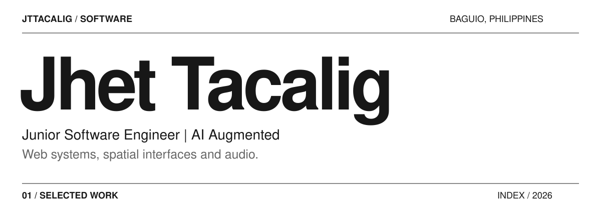</picture> 
<a href="https://dev-station2026.vercel.app"><picture><source media="(max-width: 600px)" srcset="assets/work-01-mobile.svg" />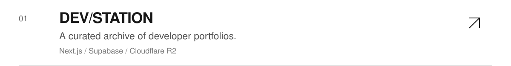</picture></a> 
<a href="https://dragontreasurecastle.com"><picture><source media="(max-width: 600px)" srcset="assets/work-02-mobile.svg" />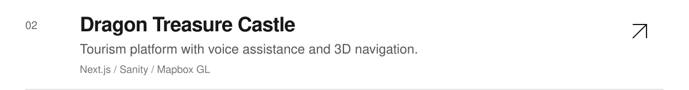</picture></a> 
<a href="https://sonance-studio-eight.vercel.app"><picture><source media="(max-width: 600px)" srcset="assets/work-03-mobile.svg" />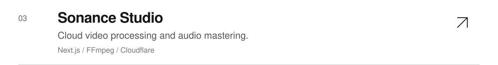</picture></a> 
<a href="https://jttacalig.vercel.app"><picture><source media="(max-width: 600px)" srcset="assets/work-04-mobile.svg" />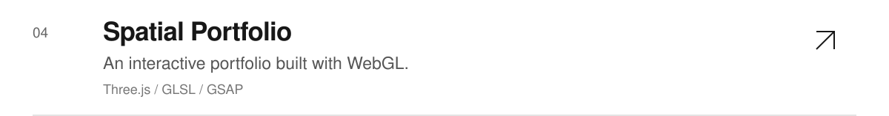</picture></a> 
<picture><source media="(max-width: 600px)" srcset="assets/practice-mobile.svg" />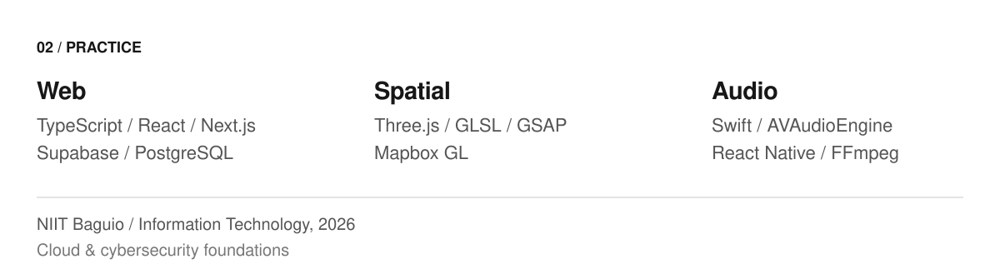</picture> 
<picture><source media="(max-width: 600px)" srcset="assets/certifications-mobile.svg" />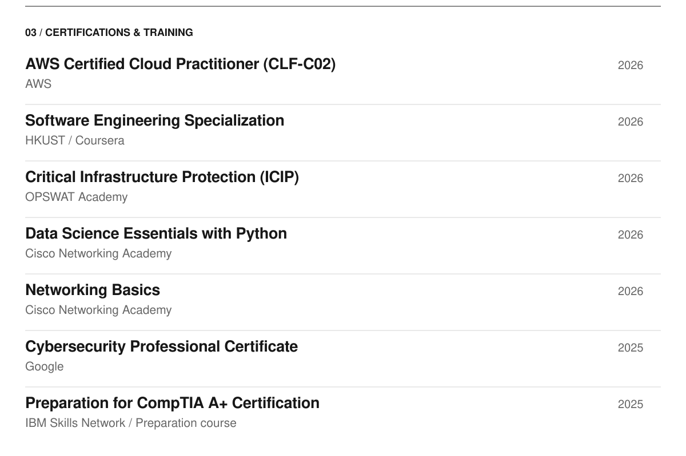</picture> 
<picture><source media="(max-width: 600px)" srcset="assets/contact-mobile.svg" />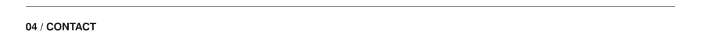</picture> 
<a href="https://jttacalig.vercel.app"><picture><source media="(max-width: 600px)" srcset="assets/portfolio-mobile.svg" />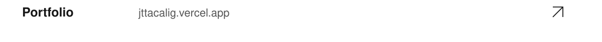</picture></a> 
<a href="mailto:jttacalig503@gmail.com"><picture><source media="(max-width: 600px)" srcset="assets/email-mobile.svg" />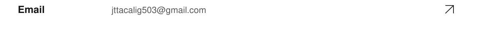</picture></a> 
<a href="https://jttacalig.vercel.app/resume"><picture><source media="(max-width: 600px)" srcset="assets/resume-mobile.svg" />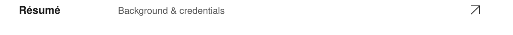</picture></a> 
<picture><source media="(max-width: 600px)" srcset="assets/end-mobile.svg" /></picture>

